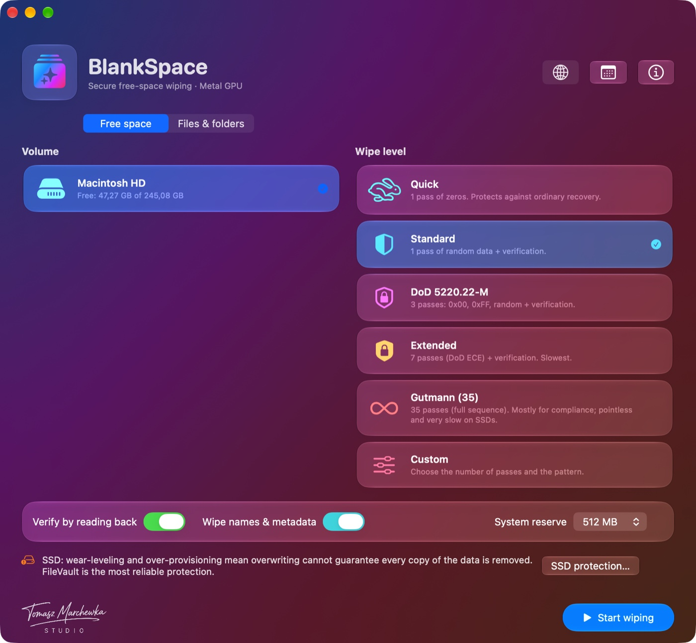
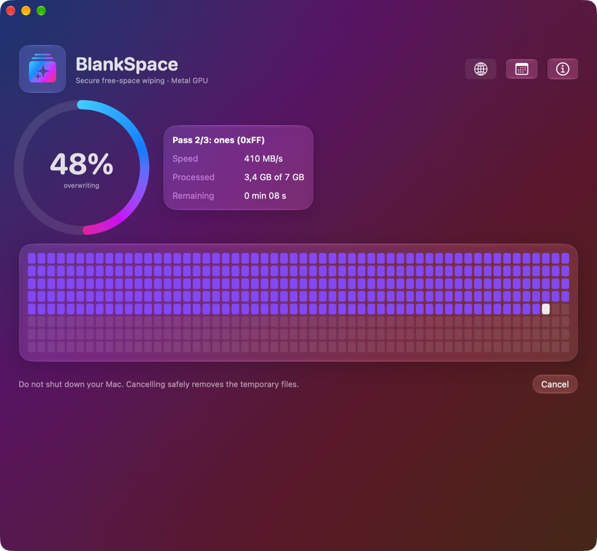
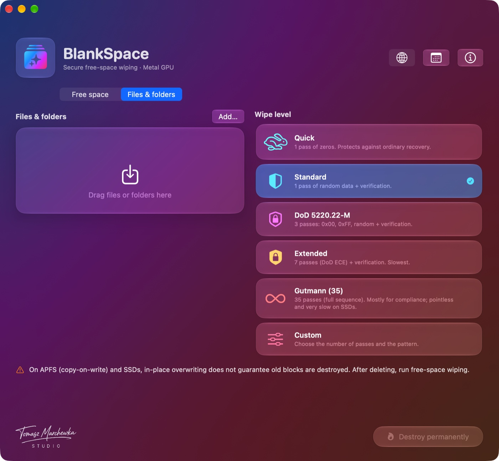
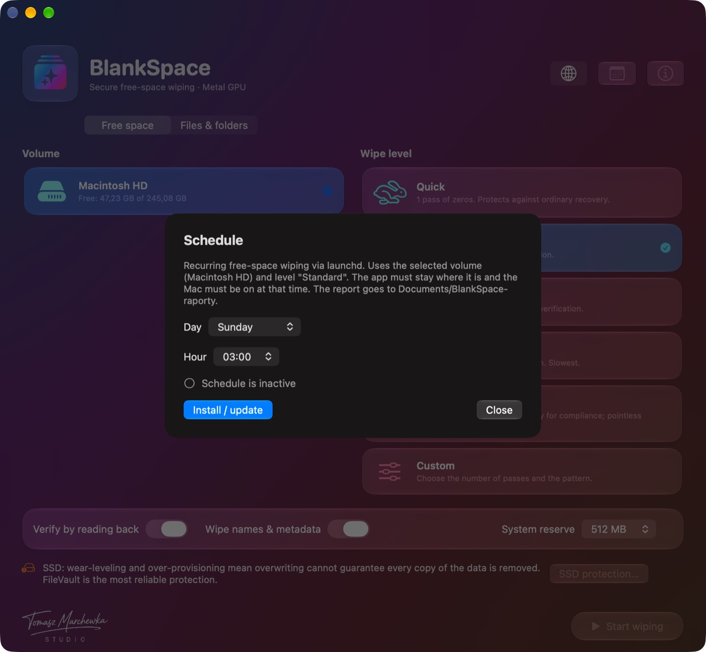

# BlankSpace

**EN:** Secure free-space wiping for macOS. Overwrites the free space on a disk so deleted data can't be recovered, and shreds chosen files and folders. Native Swift + SwiftUI (Liquid Glass) with Metal-generated random data. No network access.
**PL:** Bezpieczne czyszczenie wolnego miejsca na macOS. Nadpisuje wolne miejsce na dysku, żeby usuniętych danych nie dało się odzyskać, i niszczy wybrane pliki i foldery. Swift + SwiftUI (Liquid Glass), dane losowe generuje Metal. Bez dostępu do sieci.



<p>
  
  
</p>

## Features · Funkcje

- **Wipe levels / poziomy:** Quick (1 pass of zeros), Standard (1 random pass), DoD 5220.22-M (3 passes), Extended (7 passes), full Gutmann (35 passes), Custom (1–35 passes: random, zeros, ones, alternating or your own hex pattern).
- **Fast / szybko:** random data is generated on the GPU with Metal and overlapped with disk writes; files are written with `F_NOCACHE` and flushed with `F_FULLFSYNC`.
- **Verification / weryfikacja:** the last pass is read back from the disk and compared byte by byte.
- **Safe / bezpiecznie:** a configurable system reserve (256 MB–2 GB) is never filled, temporary files are removed on cancel or error, protected paths (`/`, home folder, `/System`…) can't be shredded, no network access, sleep is blocked while working.
- **Files & folders / pliki i foldery:** drag and drop to destroy files: overwrite, truncate, rename, delete.
- **Names & metadata / nazwy i metadane:** optional wiping of directory entries left by deleted files.
- **Schedule / harmonogram:** weekly wipes through a launchd agent, with a report saved to `Documents/BlankSpace-raporty`.
- **SSD help / pomoc dla SSD:** warns about SSD, local snapshots and FileVault, can delete local snapshots and explains cryptographic erase.
- **Menu bar & notifications / pasek menu i powiadomienia:** progress and Cancel from the menu bar, notification when done.
- **PL / EN interface**, switchable in the app.

<p>
  
</p>

## Important limits · Ważne ograniczenia

**EN:** On SSDs and APFS, overwriting can't guarantee that every copy of the data is gone (wear-leveling, over-provisioning, copy-on-write, snapshots). The most reliable protection is FileVault and, before giving a Mac away, *Erase All Content and Settings*. BlankSpace warns about this in the app. The Gutmann sequence is included for compliance and is pointless on SSDs.
**PL:** Na SSD i APFS nadpisanie nie gwarantuje usunięcia każdej kopii danych (wear-leveling, over-provisioning, copy-on-write, migawki). Najpewniejsza ochrona to FileVault i, przed oddaniem Maca, *Skasuj całą zawartość i ustawienia*. Aplikacja ostrzega o tym na ekranie. Sekwencja Gutmanna jest dla zgodności i na SSD nie ma sensu.

## Install · Instalacja

Requires macOS 26 or newer, Apple Silicon. Download `BlankSpace-1.0.dmg` from [Releases](../../releases/latest) and drag the app to Applications. The app is signed ad hoc, not notarized: on first launch right-click → **Open** → **Open**.

Wymaga macOS 26 lub nowszego, Apple Silicon. Pobierz `BlankSpace-1.0.dmg` z [Releases](../../releases/latest) i przeciągnij aplikację do Aplikacji. Aplikacja ma podpis ad hoc, bez notaryzacji: przy pierwszym uruchomieniu kliknij prawym → **Otwórz** → **Otwórz**.

## Build · Budowanie

```bash
./build.sh        # builds BlankSpace.app
./build.sh dmg    # also creates BlankSpace.dmg
```

Self-test (writes about 1–2 GB temporarily to the temp folder):

```bash
./BlankSpace.app/Contents/MacOS/BlankSpace --selftest
```

## Author

Tomasz Marchewka STUDIO
